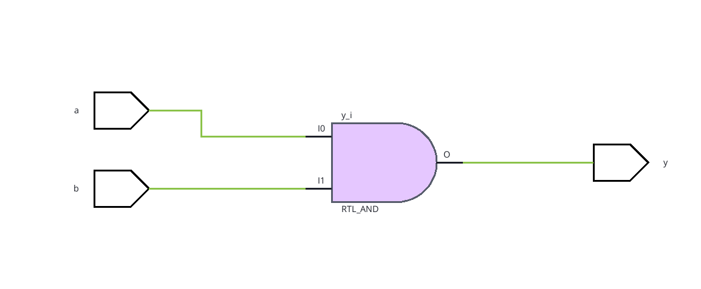

# Verilog AND Gate

Generate a simple verilog AND gate, and visualize it using
vivado!

1. Open Vivado in a new directory

2. Click `Add Sources` -> `Add or create design sources` -> `Create file` to create a new HDL file. Under `File Type` select `Verilog`, and under `filename` enter `AND`. Click `Finish`, and when any new dialogs open, click `OK` and `Yes` to confirm the default options.

3. Double-click the source under `Sources` -> `Design Sources` -> `AND` to open `AND.v`. The file should look like this (with a bunch of extra comments):

``` title="AND.v"
`timescale 1ns / 1ps

// A bunch of comments

module OR(

    );
endmodule
```

4. Modify `AND.v` to implement an AND gate. After modifying the file, click save.

``` title="AND.v"
`timescale 1ns / 1ps

// A bunch of comments

module OR(
  a, b, y
    );

input a, b;
output y;

assign y = a & b;

endmodule
```

5. Click on `RTL Analysis` -> `Open Elaborated Design` to view the circuit diagram for your verilog gate.


